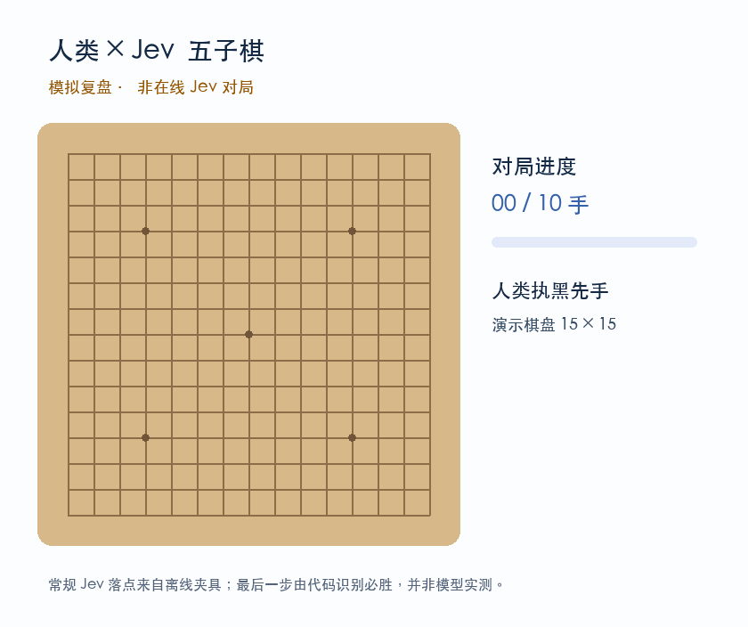

> **现在可选择谁先下：先手执黑 X，后手执白 O。**玩家执黑时点击空格开局；Jev 执黑时点击“按所选先手开局”，后端会让它从空棋盘真正选第一步。先前版本只有人类执黑、最多 20 个候选；当前使用全部合法空位，并把当前双方身份、轮次与五连规则传给模型。历史战绩属于旧版，不代表当前棋力。

## 人类与 Jev 对战动画（离线模拟复盘）



*动图循环播放，共 10 手：人类执黑、Jev 执白，最后白棋形成五连。**这不是在线模型录像**：普通回合的“Jev”落点由固定测试夹具提供，最后一步由现有 `Gomoku` 规则引擎识别必胜并落子；不含真实模型概率、用量或延迟，也不能作为 Jev 棋力证据。* 可运行 `render_gomoku_demo.py` 用本地棋局规则重新生成 GIF（仅生成动图时需要 Pillow，不需要 API Key）。要体验真正的在线人机对战，请按下文启动本地服务。

## 怎么启动并开局

本项目是**本机可玩的网页游戏**，不是纯静态 HTML；TypeSafe API Key 不允许放在前端。Python 3.10+ 即可，**无需 pip 安装依赖**。请先到控制台轮换之前在聊天中暴露的密钥。

1. 打开 VS Code 的 **Bash 终端**，进入仓库：`cd /Users/chao/Desktop/分享文档库`。
2. 在同一终端输入以下命令；看到提示后直接输入**轮换后的**密钥并回车（不会回显）。不要把密钥写进脚本、网页、命令参数或文档：

```sh
read -rs -p '输入新的 TypeSafe API Key: ' TYPESAFE_API_KEY; echo
export TYPESAFE_API_KEY
python3 docs/courses/agents/jev-ticket-triage/gomoku_server.py
```

3. 浏览器打开 `http://127.0.0.1:8766/`。默认“我先手·执黑”，点击空位后 Jev 执白应手；如改选“Jev 先手·执黑”，先按**“按所选先手开局”**，等它落下黑子后你执白落子。切换选项后必须按开局按钮，不能直接继续旧对局。右侧显示概率前六名；终端逐次打印完整 `JEV_REQUEST` / `JEV_RESPONSE`（不含 Key）。规则保底时不发请求。修改后端代码后需停止旧服务并重新启动。
4. 停止时在服务终端按 **Ctrl+C**，再运行 `unset TYPESAFE_API_KEY`。如果端口被占用，可用 `--port 8767`，并手动打开 `http://127.0.0.1:8767/`。

> [棋盘静态预览](gomoku.html)能从知识库首页打开，但**直接双击文件或在 `file://` 中看预览无法连接 API**；要玩必须运行本地服务再打开上面的 `http://127.0.0.1:8766/`。服务只监听 `127.0.0.1`，不要将端口向公网暴露。正常 Jev 应手每次会消耗账号额度；本地模型不可用时不会假装它已下棋。

**日志安全边界：**仅打印发送到 Jev 的 JSON body 和成功返回的 JSON；失败只打印 `JEV_ERROR` 加 HTTP 状态或异常类别，不打印错误正文；**不打印 `Authorization` 头或 API Key**。棋盘与候选选项会完整打印，日志很长且可能进入终端滚动记录；在其它业务场景若将真实用户数据放进 `state`，应先脱敏，不应开启这样的全量日志。服务启动后产生的新日志才会出现；历史对局不会补印。

## 谁在下棋，谁在计算？

| 阶段 | 执行方 | 可观察证据 |
| --- | --- | --- |
| 棋盘占用、四方向五连、非法落点 | `gomoku.py` 的确定性代码 | 棋盘、胜负提示、单元测试 |
| 一步必胜 / 对手下一步能五连时单点防守 | **代码直接选点**，不调用 Jev | 面板显示“确定性规则保底”，`source=rule_win/rule_block` |
| 其他正常回合的 Jev 选点 | **Jev `Choice` 选择全部空位**；AI 执黑首手 225 点、人类执黑后 AI 首手 224 点 | `source=jev`、实际棋色、模型版本、全量候选概率、confidence 与 usage；网页展示概率前六名 |
| 是否真赢、输了或平局 | `Gomoku` 规则判断 | `JEV_WON`、`HUMAN_WON` 或 `DRAW` |

原请求的问题是**硬编码“人类 X 先手、Jev O 后手”**，仅给每点最长线长度而未说明双端开放和实际棋色；如果直接让 AI 执黑，旧请求会自相矛盾。现将棋盘值固定为 `X=黑(1)`、`O=白(2)`，由 `state.roles` 动态指出谁是 AI、对手棋色、谁先手和当前轮次（增强对战的对手也可能是平台模型）；`state.rules` 明确 15×15、无禁手、每回合只在空位落一子、不可移子和吃子、横竖及两条斜线连续至少五子获胜（长连同样获胜）、满盘无胜为和棋，候选 ID 从 0 起而描述文字从 1 起。`state.strategy` 补充活三/活四、断点、多方向威胁及攻防取舍。`criteria` 对每个空位给出双方在此落子的最长连线与开放端提示，`instructions` 指明 AI 实际棋色与防守/进攻目标。首手最多 225 个选项，低于官方上限 255。**这仍不是棋局搜索**，不能凭提示词保证 Jev 不输；遇到模型调用失败将保留局面 `AI_PENDING` 供重试。见[官方 Choice](https://docs.typesafe.ai/primitives/choice)。

## 源码直接在本文：棋盘规则、模型选择与请求日志

以下是初版游戏引擎的**历史代码快照**，可用于理解基础规则和选择流程，但不包含后来新增的 `state.strategy` 和中性对手身份；**真正运行的最新提示词请以同目录 [`gomoku.py`](gomoku.py) 为准**。网页服务、HTML/JS 页面另外需要配套文件，本文后面给出服务关键代码与前端交互代码；要原样运行网页，仍须保留这些文件。

```python
"""15×15 人机五子棋：规则用代码，非强制落点由 Jev 的 Choice 选择。"""

import math
from triage import _probability, call_jev

SIZE = 15
BLACK, WHITE = 1, 2
HUMAN, JEV = BLACK, WHITE  # 旧版默认棋色；实际棋色由 first 决定
DIRECTIONS = ((1, 0), (0, 1), (1, 1), (1, -1))

def empty_board():
  return [[0] * SIZE for _ in range(SIZE)]

def run_length(board, row, col, player, dr, dc):
  count = 1
  for sign in (-1, 1):
    r, c = row + sign * dr, col + sign * dc
    while 0 <= r < SIZE and 0 <= c < SIZE and board[r][c] == player:
      count += 1
      r += sign * dr
      c += sign * dc
  return count

def is_win(board, row, col, player):
  return any(run_length(board, row, col, player, dr, dc) >= 5 for dr, dc in DIRECTIONS)

def winning_moves(board, player):
  result = []
  for row in range(SIZE):
    for col in range(SIZE):
      if board[row][col] == 0:
        board[row][col] = player
        won = is_win(board, row, col, player)
        board[row][col] = 0
        if won:
          result.append((row, col))
  return result

def line_peak(board, row, col, player):
  """若该方在此落子，最长连续线及其两端仍为空的数量。"""
  best = (0, 0)
  for dr, dc in DIRECTIONS:
    length, open_ends = 1, 0
    for sign in (-1, 1):
      r, c = row + sign * dr, col + sign * dc
      while 0 <= r < SIZE and 0 <= c < SIZE and board[r][c] == player:
        length += 1
        r += sign * dr
        c += sign * dc
      if 0 <= r < SIZE and 0 <= c < SIZE and board[r][c] == 0:
        open_ends += 1
    best = max(best, (length, open_ends))
  return best

def candidates(board):
  """全部空位，不按代码评分裁剪候选。"""
  return [(row, col) for row in range(SIZE) for col in range(SIZE)
      if board[row][col] == 0]

def move_id(row, col):
  return f"r{row:02d}c{col:02d}"

def choose_move(board, ask=call_jev, ai_player=WHITE):
  """AI 可执黑或白；规则必胜/必防不调用 Jev。"""
  if ai_player not in (BLACK, WHITE):
    raise ValueError("invalid AI color")
  opponent = WHITE if ai_player == BLACK else BLACK
  ai_symbol = "X" if ai_player == BLACK else "O"
  human_symbol = "O" if ai_player == BLACK else "X"
  immediate = winning_moves(board, ai_player)
  blocks = winning_moves(board, opponent)
  if immediate or blocks:
    selected = sorted(immediate or blocks)[0]
    return selected, {"source": "rule_win" if immediate else "rule_block",
              "reason": "代码检测到一步成五" if immediate else "代码检测到对手下一步可成五",
              "candidates": [move_id(*p) for p in (immediate or blocks)],
              "model": None, "probabilities": {}, "confidence": None, "usage": None}

  choices = candidates(board)
  if not choices:
    raise ValueError("board is full")
  criteria = {}
  for r, c in choices:
    (own, own_open) = line_peak(board, r, c, ai_player)
    (theirs, their_open) = line_peak(board, r, c, opponent)
    criteria[move_id(r, c)] = (
      f"{ai_symbol} at row {r+1}, column {c+1}: {ai_symbol} line {own}, open ends {own_open}; "
      f"occupying this cell denies {human_symbol} line {theirs}, open ends {their_open}."
    )
  state = {"rules": (
        "15x15 Gomoku, no forbidden-move restrictions. Board has exactly 15 rows and 15 columns. "
        "'.' is empty, X is black, O is white. Black X always plays first. "
        "Players strictly alternate, placing exactly one stone on an empty cell per turn. "
        "First to form at least five contiguous stones horizontally, vertically, or diagonally wins. "
        "A line with two open ends is harder to defend than one with zero or one open end. "
        "Option ids r00c00 through r14c14 use zero-based row and column; option text uses one-based numbers. "
        "Only keys listed under criteria are legal moves; never select an occupied cell."
       ),
       "roles": {"you_ai": ai_symbol, "human": human_symbol,
                 "first_player": "ai" if ai_player == BLACK else "human",
                 "to_move": ai_symbol},
       "board": ["".join(".XO"[cell] for cell in row) for row in board],
       "objective": (
         f"You control {ai_symbol}, the human controls {human_symbol}. "
         f"Build five {ai_symbol} in a row while stopping {human_symbol}. "
         f"Block open-ended {human_symbol} threats and build open {ai_symbol} lines. "
         "Choose only among empty cells; consider the full board rather than option order."
       )}
  response = ask(state, {"next_move": {
    "type": "choice", "instructions": (
      f"It is {ai_symbol}'s turn. You play {ai_symbol}; human plays {human_symbol}. "
      f"Which single listed empty cell is the best move for {ai_symbol}? "
      "Prevent opponent threats and build your own open lines; use the board and criteria, not option order."
    ),
    "criteria": criteria}})
  answer = response["answers"]["next_move"]
  distribution = answer["probabilities"]
  selected_id = answer["choice"]
  if (answer["type"] != "choice" or set(distribution) != set(criteria)
      or selected_id not in criteria or not _probability(answer["confidence"])
      or any(not _probability(p) for p in distribution.values())
      or not math.isclose(sum(distribution.values()), 1, abs_tol=0.02)
      or distribution[selected_id] != max(distribution.values())):
    raise ValueError("invalid Jev move response")
  selected = next(pos for pos in choices if move_id(*pos) == selected_id)
  return selected, {"source": "jev", "reason": "Jev Choice 从全部空位中选择",
            "candidates": list(criteria), "probabilities": distribution,
            "confidence": answer["confidence"], "model": response.get("model"),
            "usage": response.get("usage")}

class Gomoku:
  def __init__(self, ask=call_jev):
    self.ask = ask
    self.reset()

  def reset(self, first="human"):
    if first not in ("human", "ai"):
      raise ValueError("first must be human or ai")
    self.first = first
    self.ai_color = BLACK if first == "ai" else WHITE
    self.human_color = WHITE if first == "ai" else BLACK
    self.board = empty_board()
    self.status = "AI_PENDING" if first == "ai" else "PLAYING"
    self.turns = []

  def snapshot(self):
    return {"board": self.board, "status": self.status, "turns": self.turns,
    "size": SIZE, "first": self.first, "ai_color": self.ai_color,
    "human_color": self.human_color,
    "next": "human" if self.status == "PLAYING" else
      "ai" if self.status == "AI_PENDING" else None}

  def human_move(self, row, col):
    if (self.status != "PLAYING" or type(row) is not int or type(col) is not int
        or not (0 <= row < SIZE and 0 <= col < SIZE) or self.board[row][col]):
      raise ValueError("illegal or finished move")
    self.board[row][col] = self.human_color
    if is_win(self.board, row, col, self.human_color):
      self.status = "HUMAN_WON"
    elif all(cell for line in self.board for cell in line):
      self.status = "DRAW"
    else:
      self.status = "AI_PENDING"

  def ai_move(self):
    if self.status != "AI_PENDING":
      raise ValueError("not AI turn")
    (row, col), decision = choose_move(self.board, self.ask, self.ai_color)
    self.board[row][col] = self.ai_color
    if is_win(self.board, row, col, self.ai_color):
      self.status = "JEV_WON"
    elif all(cell for line in self.board for cell in line):
      self.status = "DRAW"
    else:
      self.status = "PLAYING"
    self.turns.append({"row": row, "col": col, "color": self.ai_color, **decision})
    return self.snapshot()
```

服务端发包与日志的实际逻辑（`triage.py`）：

```python
def call_jev(state, questions, log_io=False):
  key = os.environ.get("TYPESAFE_API_KEY")
  if not key:
    raise RuntimeError("未设置 TYPESAFE_API_KEY")
  payload = json.dumps({"model": "jev-latest", "state": state,
              "questions": questions}, ensure_ascii=False).encode("utf-8")
  if log_io:
    print("JEV_REQUEST " + payload.decode("utf-8"), flush=True)
  request = urllib.request.Request(
    "https://api.typesafe.ai/v1/systemone", data=payload, method="POST",
    headers={"Authorization": f"Bearer {key}", "Content-Type": "application/json"})
  try:
    with urllib.request.urlopen(request, timeout=15) as result:
      response = json.load(result)
  except urllib.error.HTTPError as error:
    if log_io:
      print(f"JEV_ERROR HTTP {error.code}", flush=True)
    raise
  except (urllib.error.URLError, TimeoutError) as error:
    if log_io:
      print(f"JEV_ERROR {type(error).__name__}", flush=True)
    raise
  if log_io:
    print("JEV_RESPONSE " + json.dumps(response, ensure_ascii=False), flush=True)
  return response

# gomoku_server.py 只在启动五子棋时启用日志；工单示例默认不记录全文。
with HTTPServer(("127.0.0.1", args.port),
        handler_for(Gomoku(ask=partial(call_jev, log_io=True)))) as server:
  server.serve_forever()
```

服务端开局调用顺序如下，**Jev 先手不是在浏览器假画一枚黑子**：

```python
# gomoku_server.py /api/reset 的关键路径
first = payload.get("first", "human")  # 只允许 "human" 或 "ai"
game.reset(first)                     # ai -> AI_PENDING；human -> PLAYING
if first == "ai":
    game.ai_move()                    # 空盘 225 个空位交给真实 Jev Choice
# 若 API 失败，状态仍为 AI_PENDING；通过 /api/retry 重试，不伪造落点。
```

Jev 执黑首回合的 `state.roles` 是 `{"you_ai":"X","human":"O","first_player":"ai","to_move":"X"}`；人类执黑后 Jev 应手则是 `{"you_ai":"O","human":"X","first_player":"human","to_move":"O"}`。这些值由 `ai_player` 动态生成，而不是只在网页上改颜色。

浏览器与本地服务交互的实际调用方式：

```js
// gomoku.js：只发送玩家坐标，不传密钥，也不允许上传棋盘代替服务端状态。
await fetch('/api/move', {
  method: 'POST', headers: {'Content-Type': 'application/json'},
  body: JSON.stringify({row: 7, col: 7})
});
// 服务端验证合法性后执行 game.human_move(row, col)，
// 随后 game.ai_move() 通过 call_jev 向模型发送全部空位。
// 选择 Jev 先手时，浏览器发 /api/reset，第一步由服务端调用模型：
await fetch('/api/reset', {
  method: 'POST', headers: {'Content-Type': 'application/json'},
  body: JSON.stringify({first: 'ai'})
});
```

因此本文包含初版游戏引擎快照、模型请求/返回日志实现与双先手前端请求方法；当前规则和 Jev 提示词以 [`gomoku.py`](gomoku.py) 为准。网页要真正运行，还需同目录的 `gomoku_server.py`、`gomoku.html`、`gomoku.js`、`gomoku.css`、`gomoku-turn.css` 和 `triage.py` 文件，文内的短摘录不能代替完整网页文件。

## 浏览器真实对战记录：Jev 也会输

**以下是改造前、人类执黑先手且最多 20 个候选点时的历史实测，不是当前双先手版本的效果。**2026-09-23 在浏览器的真实对局中，第一手玩家在棋盘中心 `(8,8)` 放黑子，Jev `jev-1.13.0` 从 **20 个候选点**里选择白子 `(7,7)`；返回 `probabilities["r06c06"] = 0.33`，`confidence = 0.29`，`input_tokens = 2167`，`output_tokens = 263`。**0.29 很低，并不证明棋力好。**

在同一浏览器对局稍后的状态快照中，前三次白子回应来自 `jev-1.13.0`，第 4 次走代码 `rule_block`；最终状态为 **`HUMAN_WON`**。前三次模型应手分别是 `(7,7)`、`(8,7)`、`(6,7)`；其选点概率为 `0.33`、`0.20`、`0.56`，置信度为 `0.29`、`0.15`、`0.53`。**这是旧版本一次短局的记录，不是当前版本的胜率评测**。

### 全盘选项与规则说明的验证范围

双先手版离线验证：人类先手后 `criteria` 有 **224 个合法空位**，Jev 先手空盘有 **225 个**；后者通过模拟客户端从空盘选黑棋、用户随后落白棋。两种模式的 `roles`、候选说明、胜负规则均有测试；浏览器使用标记为 `fake-test-only` 的本地测试服务验收过先手切换、棋色与页面展示，**不是 Jev 在线实测**。终端入参/出参日志通过模拟 HTTP 验证不含 Authorization。**没有对最新双先手规则版本完成在线多盘对比**，不能声称模型已变强或实际胜率、费用如何。

## 自己核验与继续改进

离线运行测试，不调用模型 API：

```sh
python3 -m unittest discover -s docs/courses/agents/jev-ticket-triage -p 'test_*.py' -v
```

覆盖四方向五连、远角合法落点、全盘空位、非法落点、防守/必胜标记、响应格式、请求来源限制和错误不伪造。要判断“给全之后有没有变强”，需在**相同开局/同一批人类落子序列**下对比旧 20 点版本与全盘版本的多盘胜率、误防率、输入 Token、耗时；不要仅凭本篇旧记录或一盘胜负下结论。如果要更强的棋手，应考虑棋局搜索或专用棋类 AI，而非夸大 Jev 的设计用途。

## 来源

- [TypeSafe Quick Start：请求与授权](https://docs.typesafe.ai/introduction/quickstart)
- [Choice：多候选选点与概率输出](https://docs.typesafe.ai/primitives/choice)
- [Jev 模型限制与语言支持](https://docs.typesafe.ai/models)
- [Jev 1.13 已知弱项](https://docs.typesafe.ai/model-jaggedness/jev-1.13)